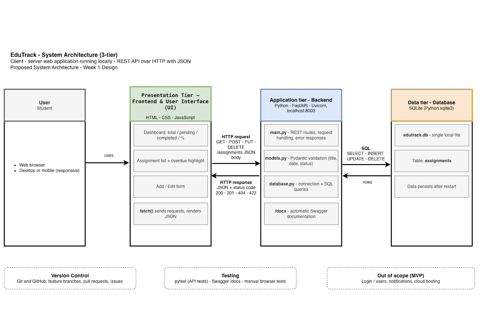

# EduTrack — Student Assignment & Progress Tracker

**Module:** CPU4106 — Group Project  
**University:** Bath Spa University / Global Banking School (GBS)  
**Project Theme:** UN Sustainable Development Goal 4 (SDG 4) — Quality Education  
**Project Type:** Group Software Development Project  
**Development Period:** Weeks 1–4, October 2026  
**Presentation:** Week 5, November 2026  
**Version:** 1.0 — Academic Prototype

---

## 1. Project Overview

EduTrack is a student assignment and progress tracking web application developed as part of the CPU4106 Group Project.

The application supports **SDG 4 — Quality Education** by helping students organise academic assignments, monitor deadlines, track task completion and manage their coursework more effectively.

EduTrack is implemented as a responsive, locally hosted, single-user web application.

It combines an HTML, CSS and JavaScript frontend with a Python FastAPI REST API and an SQLite database.

The project demonstrates practical skills in:

- Software development and system design
- Database design and SQL
- Python backend development
- REST API implementation
- Frontend development and integration
- Input validation and error handling
- Automated and manual software testing
- Agile project management
- Git and GitHub collaboration

## 2. Project Aim and Objectives

### Aim

To design and implement a functional student assignment management application that supports academic organisation and progress tracking.

### Objectives

- Create new assignments with relevant details.
- View existing assignments and their deadlines.
- Edit assignment information.
- Mark assignments as pending or completed.
- Delete assignments when no longer needed.
- Track assignment completion and overdue tasks.
- Store assignment data persistently using SQLite.
- Connect the frontend and backend using REST API endpoints.
- Validate assignment data using Pydantic.
- Test functionality using pytest, Swagger UI and browser developer tools.

## 3. Implemented Features

The current EduTrack prototype implements the following features:

| Feature | Implementation |
|---|---|
| Assignment dashboard | Displays assignment records and progress statistics |
| Create assignment | Adds a new assignment using POST |
| View assignments | Retrieves stored assignments using GET |
| View assignment details | Displays assignment information and descriptions |
| Edit assignment | Updates existing assignment information using PUT |
| Complete assignment | Changes an assignment's status to completed |
| Reopen assignment | Changes a completed assignment back to pending |
| Delete assignment | Removes an assignment using DELETE |
| Due dates | Stores assignment deadlines |
| Overdue tracking | Identifies pending assignments past their due dates |
| Module | Optional academic module field |
| Priority | Optional low, medium or high priority |
| Status filtering | Filters all, pending, completed and overdue assignments |
| Progress statistics | Shows total, pending, completed, overdue and completion percentage |
| Persistent storage | Saves records in a local SQLite database |
| Responsive interface | Supports desktop, tablet and mobile layouts |
| Input validation | Validates API request data using Pydantic |
| Error handling | Handles invalid data and missing assignment records |

### Assignment Status

The implemented system supports two stored status values:

- `pending`
- `completed`

New assignments automatically start with `pending` status.

### Priority Values

The backend accepts:

- `low`
- `medium`
- `high`

Priority is optional.

## 4. Project Scope

### In Scope

- Student assignment management
- Assignment creation, retrieval, editing and deletion
- Deadline management
- Assignment completion tracking
- Dashboard progress statistics
- Responsive frontend design
- SQLite database persistence
- FastAPI REST API
- Input validation
- Automated and manual testing
- Technical documentation

### Out of Scope

- Student authentication and multiple user accounts
- Lecturer or administrator accounts
- Attendance monitoring
- Assignment grading
- Online assignment file submissions
- Student–lecturer messaging
- Online course delivery
- AI recommendations
- Production cloud hosting

EduTrack is an academic prototype rather than a production learning management system.

## 5. Technology Stack

| Technology | Purpose |
|---|---|
| Python | Backend programming |
| FastAPI | REST API implementation |
| SQLite3 | Local database storage |
| Pydantic | Data validation |
| Uvicorn | Application server |
| pytest | Automated testing |
| HTTPX / TestClient | API testing |
| HTML5 | Frontend structure |
| CSS3 | User interface and responsive layout |
| JavaScript | Frontend functionality and API communication |
| Git | Version control |
| GitHub | Collaboration, code reviews and pull requests |
| GitHub Issues / Projects | Task management |
| Microsoft Excel | Gantt Chart and milestones |
| diagrams.net | Technical diagrams |
| VS Code | Development environment |

## 6. System Architecture

EduTrack follows a three-tier architecture.

### Presentation Tier

HTML, CSS and JavaScript provide the dashboard, assignment forms, filtering and progress information.

### Application Tier

Python and FastAPI process HTTP requests, validate data using Pydantic and provide REST API endpoints.

### Data Tier

SQLite stores assignment records and supports CRUD operations using parameterised SQL queries.

### Data Flow

```text
Student
   |
   v
Frontend — HTML / CSS / JavaScript
   |
   | HTTP Requests / JSON
   v
Python FastAPI REST API
   |
   | Pydantic Validation
   v
SQLite Database
   |
   v
API Response
   |
   v
Updated Student Dashboard
```



## 7. Project Structure

```text
Summative_GroupProject/
|
|-- backend/
|   |-- main.py
|   |-- models.py
|   |-- database.py
|   |-- requirements.txt
|   `-- tests/
|       |-- test_api.py
|       `-- test_database.py
|
|-- frontend/
|   |-- index.html
|   |-- style.css
|   `-- script.js
|
|-- docs/
|   |-- README.md
|   |-- api-specification.md
|   |-- database-design.md
|   |-- database-erd.png
|   |-- system-architecture.png
|   `-- evidence/
|       `-- integration-testing/
|
|-- .gitignore
`-- README.md
```

Additional technical diagrams and planning documents are maintained in the `docs/` directory and the associated GitHub Issues.

## 8. Installation and Local Development

EduTrack requires Python and the project dependencies.

The following instructions run the connected FastAPI and SQLite application locally.

### Step 1 — Clone the Repository

```bash
git clone https://github.com/petbul4epm/Summative_GroupProject.git
cd Summative_GroupProject
```

**Note:** This is a private repository. GitHub access is required to clone it.

### Step 2 — Create a Virtual Environment

```bash
python -m venv .venv
```

### Step 3 — Activate the Virtual Environment

**macOS / Linux:**

```bash
source .venv/bin/activate
```

**Windows PowerShell:**

```powershell
.venv\Scripts\Activate.ps1
```

### Step 4 — Install Dependencies

```bash
python -m pip install -r backend/requirements.txt
```

### Step 5 — Start FastAPI

From the project root:

```bash
python -m uvicorn backend.main:app --reload --port 8000
```

### Step 6 — Open the Application

**Connected EduTrack dashboard:**

http://127.0.0.1:8000/app/

**Interactive API documentation:**

http://127.0.0.1:8000/docs

**API health endpoint:**

http://127.0.0.1:8000/

The SQLite assignments table is initialised automatically when the application starts.

The frontend and REST API run on the same local server.

### Important Hosting Information

EduTrack is currently a **locally hosted academic prototype**.

The `127.0.0.1` URLs only work on the computer running the FastAPI server.

The application has not been deployed to a public production hosting service.

### Browser Demo Mode

The frontend also supports a browser-only demonstration mode.

This is enabled when:

- `frontend/index.html` is opened directly, or
- `?demo=1` is added to the application URL.

Browser demo mode stores example records using browser local storage.

**Demo mode is separate from the connected FastAPI and SQLite implementation and should not be used as evidence of database integration.**

## 9. REST API Endpoints

The FastAPI backend implements the following endpoints:

| Method | Endpoint | Description | Success |
|---|---|---|---|
| GET | `/` | API health check | 200 |
| POST | `/assignments` | Create an assignment | 201 |
| GET | `/assignments` | Retrieve all assignments | 200 |
| GET | `/assignments/{assignment_id}` | Retrieve an assignment by ID | 200 |
| PUT | `/assignments/{assignment_id}` | Update an assignment | 200 |
| DELETE | `/assignments/{assignment_id}` | Delete an assignment | 204 |

### Example — Create an Assignment

**POST `/assignments`**

```json
{
  "title": "Database Coursework",
  "description": "Complete database design documentation",
  "due_date": "2026-11-20",
  "module": "CPU4106",
  "priority": "high"
}
```

A successful request returns HTTP `201 Created`.

The backend generates an assignment ID and stores its initial status as `pending`.

### API Error Handling

The implementation uses the following HTTP responses:

- `404 Not Found` — requested assignment does not exist.
- `422 Unprocessable Content` — invalid request data.
- `204 No Content` — assignment successfully deleted.

The frontend correctly handles DELETE 204 responses without attempting to parse an empty JSON body.

For detailed documentation, see the [REST API Specification](docs/api-specification.md).

## 10. SQLite Database Design

EduTrack uses a single SQLite table called `assignments`.

| Field | Data Type | Description |
|---|---|---|
| `id` | INTEGER | Primary key |
| `title` | TEXT | Assignment title |
| `description` | TEXT | Optional assignment description |
| `due_date` | TEXT | Deadline in YYYY-MM-DD format |
| `status` | TEXT | Pending or completed |
| `module` | TEXT | Optional academic module |
| `priority` | TEXT | Optional assignment priority |

The database is stored locally at:

`backend/edutrack.db`

Database operations are implemented using Python's `sqlite3` library.

SQL queries use parameterised statements to avoid directly concatenating user input into SQL commands.

The database automatically creates the `assignments` table when FastAPI starts.

See:

- [Database Design](docs/database-design.md)
- [Entity Relationship Diagram](docs/database-erd.png)

## 11. Input Validation

Pydantic validates assignment data before it is processed by the database.

| Field | Validation |
|---|---|
| Title | Required, 1–200 characters |
| Description | Optional, maximum 2,000 characters |
| Due date | Valid date in YYYY-MM-DD format |
| Module | Optional, maximum 100 characters |
| Priority | Low, medium, high or null |
| Status | Pending or completed during updates |
| Assignment ID | Integer path parameter |

Invalid API requests return HTTP 422.

Examples of rejected values include:

- Empty titles
- Invalid dates
- Unsupported priority values
- Unsupported status values
- Descriptions exceeding 2,000 characters
- Module names exceeding 100 characters

**Known validation limitation:** The current API rejects empty titles but does not explicitly reject titles consisting only of whitespace.

## 12. Automated Testing

EduTrack includes automated tests for the SQLite database and FastAPI REST API.

The tests are implemented using pytest and FastAPI TestClient.

### Database Testing

The database tests cover:

- SQLite connections
- Table creation
- Table structure
- Default assignment status
- Assignment creation
- Assignment retrieval
- Assignment updates
- Assignment deletion

### FastAPI Testing

The API tests cover:

- Successful assignment creation
- Retrieval of assignment records
- Retrieval by assignment ID
- Updating assignment fields
- Deleting assignments
- HTTP response codes
- Invalid request handling
- Pydantic validation rules
- Frontend-serving behaviour

### Recorded Results

During the project, the automated test suite progressed from 17 passing tests to **22 passing tests**, as documented in the integration QA record.

The documented execution reported:

- 22 tests passed
- 0 tests failed
- 1 non-blocking dependency deprecation warning

These are previously recorded results, not a claim of a fresh test run on the final submission commit.

### Running the Tests

From the project root:

```bash
python -m pytest backend/tests -q
```

The automated tests are available in:

- `backend/tests/test_database.py`
- `backend/tests/test_api.py`

## 13. Frontend–Backend Integration Testing

The frontend and FastAPI backend have been integrated successfully.

The connected application communicates with the REST API through HTTP requests.

Manual integration testing was performed using the application dashboard and Chrome Developer Tools.

### CRUD Integration Results

| Operation | HTTP Method | Expected Status | Recorded Result |
|---|---|---|---|
| Create assignment | POST | 201 | Passed |
| Retrieve assignments | GET | 200 | Passed |
| Update assignment | PUT | 200 | Passed |
| Delete assignment | DELETE | 204 | Passed |

Additional functionality tested included:

- Displaying assignment records in the dashboard
- Editing existing assignments
- Updating completion status
- Recalculating dashboard statistics
- Displaying assignment descriptions
- Checking API responses through the browser Network tab

### Integration Testing Evidence

The manual testing screenshots are available in:

[Integration Testing Evidence](docs/evidence/integration-testing/)

The evidence was added through:

[Pull Request #47 — Integration Testing Evidence](https://github.com/petbul4epm/Summative_GroupProject/pull/47)

The frontend–backend integration was delivered through:

[Pull Request #45 — Frontend–Backend Integration](https://github.com/petbul4epm/Summative_GroupProject/pull/45)

## 14. System Design and Technical Documentation

The project includes design diagrams and documentation explaining the implementation.

| Document | Purpose |
|---|---|
| [System Architecture](docs/system-architecture.png) | Three-tier system architecture |
| [Database ERD](docs/database-erd.png) | SQLite assignments table |
| [Database Design](docs/database-design.md) | Database schema and CRUD implementation |
| [REST API Specification](docs/api-specification.md) | API endpoints and validation |
| [Technical Documentation Index](docs/README.md) | Documentation overview |
| [Integration QA Record](docs/integration-qa-record.md) | Integration testing record |
| [User Story Traceability](docs/user-story-traceability.md) | User story implementation and limitations |
| [Integration Testing Screenshots](docs/evidence/integration-testing/) | Practical testing evidence |

### Data Flow Diagrams

Two Data Flow Diagrams were developed:

**Level 0 — Context Diagram**

Represents EduTrack as one system and illustrates how students exchange information with the application.

**Level 1 — Data Flow Diagram**

Expands the system into four assignment-management processes:

1. Create Assignment
2. View Assignments
3. Update Assignment
4. Delete Assignment

Both diagrams identify how assignment information moves between the student, application processes and SQLite data store.

The diagrams were integrated through:

[Pull Request #48 — Data Flow Diagrams](https://github.com/petbul4epm/Summative_GroupProject/pull/48)

## 15. Project Management and Agile Methodology

The project was organised over four development weeks, followed by a group presentation and live viva in Week 5.

The team used:

- Agile project management principles
- Weekly development activities
- GitHub Issues for task allocation
- GitHub Projects for progress tracking
- Git branches and Pull Requests
- Peer reviews before merging changes into `main`
- A Gantt Chart and milestone tracker

### Development Schedule

| Week | Activities |
|---|---|
| Week 1 | Team planning, scope, requirements, architecture, Gantt Chart and GitHub setup |
| Week 2 | SQLite database development, initial backend implementation and testing |
| Week 3 | REST API development, validation, automated testing and technical diagrams |
| Week 4 | Frontend–backend integration, manual testing, quality assurance and documentation |
| Week 5 | Final submission, group presentation and live viva |

### Gantt Chart

The project Gantt Chart documents the planned development activities, responsibilities and milestones.

The Excel file is available as an attachment to:

[Issue #27 — EduTrack Gantt Chart](https://github.com/petbul4epm/Summative_GroupProject/issues/27)

The Gantt Chart represents the original project schedule. Its task statuses should not be interpreted as the final implementation status unless updated separately.

## 16. Team Roles and Contributions

| Team Member | Main Responsibility |
|---|---|
| Sergiu | Python backend development, SQLite database, FastAPI REST endpoints, Pydantic validation, automated backend tests, integration testing evidence and technical diagrams |
| Petya | Frontend development, UI integration, responsive design and integration QA |
| Shahzad | Frontend development, interface improvements and testing |
| Farah | Project coordination, Scrum activities, documentation and planning |

All team members contributed to collaborative planning, reviews and preparation for the group presentation.

## 17. GitHub Collaboration

Development work was organised through GitHub branches, Pull Requests and code reviews.

Major contributions included:

- Backend implementation and database integration
- REST API and input validation
- Automated backend testing
- Responsive frontend implementation
- Frontend–backend integration
- Manual integration testing evidence
- Database and architecture documentation
- Data Flow Diagrams

### Selected Pull Requests

- [PR #39 — Backend Implementation](https://github.com/petbul4epm/Summative_GroupProject/pull/39)
- [PR #44 — Backend Validation and Tests](https://github.com/petbul4epm/Summative_GroupProject/pull/44)
- [PR #45 — Frontend–Backend Integration](https://github.com/petbul4epm/Summative_GroupProject/pull/45)
- [PR #47 — Integration Testing Evidence](https://github.com/petbul4epm/Summative_GroupProject/pull/47)
- [PR #48 — Data Flow Diagrams](https://github.com/petbul4epm/Summative_GroupProject/pull/48)

These contributions are included in the project's GitHub history.

## 18. Known Limitations and Future Improvements

The current application meets the core assignment-management objectives but remains a local academic prototype.

Features not implemented in the current version include:

- Search assignments by title
- Sort assignments by deadline using a user-controlled sorting feature
- Filter assignments by academic module
- Multiple user accounts and authentication
- Cloud deployment
- Assignment file uploads
- Advanced reporting and analytics

The implemented filtering options are All, Pending, Completed and Overdue.

Further improvements could include:

- Search and sorting controls
- Additional filtering options
- Stronger whitespace and date validation
- Expanded browser acceptance testing
- Multi-user authentication
- Cloud-hosted deployment
- Enhanced progress analytics

These are future improvements rather than features claimed as completed.

## 19. Demonstration for Live Viva

The EduTrack application can be demonstrated locally by starting FastAPI and opening:

http://127.0.0.1:8000/app/

### Suggested Live Demonstration

1. Open the EduTrack dashboard.
2. Create a new assignment.
3. View the assignment in the dashboard.
4. Edit its information or due date.
5. Mark the assignment as completed.
6. Check the updated progress statistics.
7. Delete the assignment.
8. Refresh the page and confirm the updated records.
9. Open Swagger UI to explain the FastAPI endpoints.

Swagger UI:

http://127.0.0.1:8000/docs

The demonstration uses the connected FastAPI and SQLite implementation rather than browser-only demo mode.

## 20. Project Outcome

EduTrack demonstrates the integration of frontend development, Python backend programming, REST APIs and persistent SQLite storage in a functional student assignment management prototype.

The project successfully implemented its core CRUD functionality and provided practical experience in:

- Software design and architecture
- Database management
- REST API development
- Frontend–backend integration
- Data validation
- Automated and manual testing
- Technical documentation
- Agile teamwork and GitHub collaboration

The completed prototype supports the project's SDG 4 theme by providing a practical tool for organising academic assignments and monitoring progress.

---

**EduTrack — CPU4106 Group Project**  
**Bath Spa University / Global Banking School**  
**SDG 4 — Quality Education**  
**October–November 2026**
