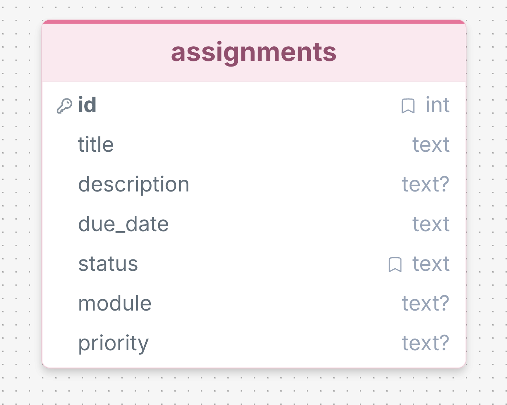

# EduTrack – Database Design

**Project:** EduTrack – Student Assignment & Progress Tracker  
**Module:** CPU4106 Group Project  
**Database:** SQLite  
**Status:** Draft for Team Review

## 1. Database Overview

EduTrack uses SQLite to store assignments for a local, single-user student assignment tracker.

The database contains one table named `assignments`, supporting the creation, viewing, updating, completion and deletion of academic tasks.

The proposed schema contains seven fields. The optional `module` and `priority` fields require confirmation from the team before implementation.

## 2. Database Table Specification

| Field | SQLite Type | Required | Key / Default | Validation |
|---|---|---|---|---|
| id | INTEGER | Auto-generated | PRIMARY KEY AUTOINCREMENT | Generated by database |
| title | TEXT | Yes | — | Not blank; maximum 200 characters |
| description | TEXT | No | NULL | Maximum 2000 characters |
| due_date | TEXT | Yes | — | Valid date in YYYY-MM-DD format |
| status | TEXT | Yes | DEFAULT 'pending' | Only pending or completed |
| module | TEXT | No | NULL | Maximum 100 characters |
| priority | TEXT | No | NULL | Only low, medium or high |

## 3. Data Integrity Rules

The backend will validate required fields, maximum text lengths and valid calendar dates.

The `status` field accepts only `pending` or `completed`. The optional `priority` field accepts only `low`, `medium` or `high`.

SQLite constraints should also enforce permitted values. Assignment IDs are generated automatically by the database.

## 4. Entity Relationship Diagram

The first version of EduTrack uses one database entity: `assignments`.

No foreign-key relationships are required because the agreed prototype does not include additional tables.

## 5. Design Rationale

SQLite is suitable for this local prototype because it is lightweight and does not require a separate database server.

A single table supports the agreed assignment-tracking functionality without introducing unnecessary complexity.

The project does not include login, student accounts, lecturer grading, online submissions or attendance tracking.

## 6. Next Steps

1. Confirm optional `module` and `priority` fields with the team.
2. Implement the SQLite schema in `backend/database.py`.
3. Implement data validation using Pydantic.
4. Create REST API endpoints using FastAPI.
5. Test CRUD operations with synthetic data.

**Implementation Status:** Proposed database design; implementation and testing are pending.
